# CoWorkHub

Aplicación web para gestionar una red de coworking: sedes, salas, equipamiento, planes de membresía,
miembros y reservas. Evita las reservas duplicadas (incluso con solicitudes simultáneas), controla las horas
que consume cada miembro, aplica una regla única para cobrar cancelaciones y limita a cada usuario a lo que le
corresponde según su rol.

Tiene un **backend** con una API REST en Spring Boot, un **frontend** en HTML, CSS y JavaScript que consume
esa API, y una base de datos **MySQL**.

## Integrantes

Trabajo individual: Heiling (GitHub: heiling-18).

## Tecnologías

| Capa | Tecnología |
|---|---|
| Lenguaje | Java 21 |
| Backend | Spring Boot 4.1.2 (Web MVC, Data JPA, Validation, Security, Actuator) |
| Seguridad | Spring Security + JWT (jjwt 0.13) + BCrypt |
| Base de datos | MySQL 8.0 (en Docker) |
| Documentación | springdoc-openapi 3.2 (Swagger UI) |
| Frontend | HTML5, CSS3 y JavaScript (fetch API) |
| Utilidades | Lombok, Maven Wrapper |
| Pruebas | Postman, curl y PowerShell |

## Requisitos previos

- **JDK 21** o superior (`java -version`).
- **Docker Desktop** (o MySQL 8 instalado).
- No hace falta instalar Maven: el proyecto trae `mvnw` / `mvnw.cmd`.
- Opcional: **Postman** e **MySQL Workbench**.

## Inicio rápido en otro computador

Con **Git**, **JDK 21** y **Docker Desktop abierto**, en PowerShell:

```powershell
# 1. Comprobar requisitos
java -version            # debe decir 21 o superior
docker --version         # Docker Desktop debe estar abierto ("Engine running")

# 2. Descargar el proyecto
git clone https://github.com/heiling-18/coworkhub.git
cd coworkhub

# 3. Levantar MySQL en Docker (puerto 3307 del PC)
docker compose up -d
docker ps                # esperar a que STATUS diga (healthy)

# 4. Arrancar la aplicación (la primera vez descarga dependencias: 2-5 min)
.\mvnw.cmd spring-boot:run
```

Cuando aparezca `Started CoworkhubApplication`, abrir:

- Frontend: http://localhost:8080/ (usuarios `admin`, `recepcion`, `ana`, `luis`; contraseña `clave123`)
- Swagger: http://localhost:8080/doc/swagger-ui.html

No hay que configurar variables de entorno: todas tienen un valor por defecto (ver más abajo).
Si un puerto está ocupado o algo falla, vaya a [Solución de problemas](#solución-de-problemas).

## Instalación

```bash
git clone https://github.com/heiling-18/coworkhub.git
cd coworkhub
```

## Preparar MySQL

### Opción A: Docker (recomendada)

```bash
docker compose up -d
docker compose logs -f mysql      # esperar "ready for connections" y salir con Ctrl+C
```

Esto crea el contenedor `coworkhub-mysql` (MySQL 8.0) con la base, el usuario y la contraseña `coworkhub`.
Los datos quedan en el volumen `coworkhub-datos`.

> El contenedor publica el puerto **3307** del PC (el 3306 suele estar ocupado por un MySQL instalado).
> Si su 3306 está libre y prefiere usarlo, cambie `3307:3306` en `docker-compose.yml` y la variable `DB_URL`.

Sin docker compose, en una sola línea:

```bash
docker run -d --name coworkhub-mysql -e MYSQL_DATABASE=coworkhub -e MYSQL_USER=coworkhub -e MYSQL_PASSWORD=coworkhub -e MYSQL_ROOT_PASSWORD=root -p 3307:3306 -v coworkhub-datos:/var/lib/mysql mysql:8.0 --default-time-zone=-05:00
```

| Acción | Comando |
|---|---|
| Ver el contenedor | `docker ps` |
| Detener / iniciar | `docker compose stop` / `docker compose start` |
| Consola MySQL | `docker exec -it coworkhub-mysql mysql -u coworkhub -p coworkhub` |
| Borrar contenedor y datos | `docker compose down -v` |

### Opción B: MySQL instalado

Cree la base y el usuario:

```sql
CREATE DATABASE coworkhub CHARACTER SET utf8mb4;
CREATE USER 'coworkhub'@'%' IDENTIFIED BY 'coworkhub';
GRANT ALL PRIVILEGES ON coworkhub.* TO 'coworkhub'@'%';
```

y ajuste `DB_URL` al puerto de su MySQL (normalmente 3306).

### Tablas y datos de prueba

- Al arrancar, Hibernate crea las tablas (`spring.jpa.hibernate.ddl-auto=create`) y ejecuta
  **`src/main/resources/import.sql`**. Cada arranque deja la base con los mismos datos.
- **`src/main/resources/migration.sql`** crea todas las tablas y carga los mismos datos sin arrancar la app:

```bash
docker exec -i coworkhub-mysql mysql -ucoworkhub -pcoworkhub coworkhub < src/main/resources/migration.sql
```

## Configuración con variables de entorno

Todas tienen un valor por defecto para desarrollo; en otro entorno se cambian sin tocar el código.

| Variable | Para qué sirve | Valor por defecto |
|---|---|---|
| `DB_URL` | URL JDBC de MySQL | `jdbc:mysql://localhost:3307/coworkhub?serverTimezone=America/Bogota` |
| `DB_USUARIO` | Usuario de la base | `coworkhub` |
| `DB_CONTRASENA` | Contraseña de la base | `coworkhub` |
| `JWT_SECRETO` | Clave para firmar los JWT (mínimo 32 caracteres) | clave de desarrollo |

Ejemplo en PowerShell:

```powershell
$env:DB_URL = "jdbc:mysql://localhost:3306/coworkhub"
$env:JWT_SECRETO = "una-clave-larga-y-secreta-de-al-menos-32-caracteres"
.\mvnw.cmd spring-boot:run
```

Otras propiedades en `application.properties`: `app.jwt.expiracion-minutos=60`, `app.zona-horaria` y
`app.reloj.fijo` (fija la hora del negocio para pruebas, por ejemplo `2030-06-03T08:00:00`).

## Ejecución

### Backend

Con MySQL corriendo:

```bash
./mvnw spring-boot:run          # Windows: .\mvnw.cmd spring-boot:run
```

Si algo raro pasa después de cambiar código, limpie lo compilado: `.\mvnw.cmd clean spring-boot:run`.

| Dirección | Qué es |
|---|---|
| http://localhost:8080/actuator/health | Salud del servicio: `{"status":"UP"}` |
| http://localhost:8080/doc/swagger-ui.html | **Swagger UI** |
| http://localhost:8080/v3/api-docs | OpenAPI en JSON (copia en `docs/openapi.json`) |

### Frontend

El frontend está en `src/main/resources/static/` y lo sirve el mismo Spring Boot, así que no necesita otro
servidor: con el backend corriendo, abra **http://localhost:8080/**.

## Solución de problemas

### El puerto de MySQL (3307) está ocupado

Síntoma al hacer `docker compose up -d`: `ports are not available: ... 0.0.0.0:3307`.

1. Ver qué programa lo usa (opcional):
   ```powershell
   netstat -ano | findstr :3307
   ```
2. Usar otro puerto, por ejemplo 3308. En `docker-compose.yml` cambie la línea de `ports`:
   ```yaml
   ports:
     - "3308:3306"
   ```
3. Recree el contenedor y diga a la app el nuevo puerto **en la misma terminal** donde la va a arrancar:
   ```powershell
   docker compose up -d
   $env:DB_URL = "jdbc:mysql://localhost:3308/coworkhub?serverTimezone=America/Bogota"
   .\mvnw.cmd spring-boot:run
   ```

### El puerto de la app (8080) está ocupado

Síntoma al arrancar: `Web server failed to start. Port 8080 was already in use.`

```powershell
netstat -ano | findstr :8080          # ver el PID del programa que lo usa (opcional)
$env:SERVER_PORT = "8081"             # arrancar la app en otro puerto
.\mvnw.cmd spring-boot:run
```

Y abra http://localhost:8081/ (y Swagger en http://localhost:8081/doc/swagger-ui.html).
Si el 8080 lo ocupa una ejecución anterior de esta misma app, basta con cerrarla (`Ctrl+C` en su terminal)
o terminar el proceso con `taskkill /PID <pid> /F`.

### Otros errores frecuentes

| Mensaje | Causa | Solución |
|---|---|---|
| `failed to connect to the docker API` | Docker Desktop está cerrado | Abrirlo y esperar *Engine running* |
| `Communications link failure` | La app arrancó antes que MySQL | `docker ps`, esperar `(healthy)` y arrancar de nuevo |
| `container name "/coworkhub-mysql" is already in use` | Quedó un contenedor anterior | `docker rm -f coworkhub-mysql` y `docker compose up -d` |
| `release version 21 not supported` | Java anterior a 21 | Instalar JDK 21 y abrir una terminal nueva |
| `mvnw.cmd` no se reconoce | En PowerShell falta `.\` | `.\mvnw.cmd spring-boot:run` |
| Comportamiento raro tras cambiar código | Clases viejas compiladas | `.\mvnw.cmd clean spring-boot:run` |
| Falla el escenario 6 de Postman | Pasaron varias horas desde el arranque | Reiniciar la app (recarga `import.sql`) |

Para detener todo: `Ctrl+C` en la terminal de la app y `docker compose stop`.

## Usuarios de prueba

La contraseña de todos es **`clave123`** (en la base se guarda con BCrypt).

| Usuario | Rol | Miembro |
|---|---|---|
| `admin` | ADMIN | — |
| `recepcion` | RECEPTIONIST | — |
| `ana` | MEMBER | Ana Gómez (id 1, plan Premium) |
| `luis` | MEMBER | Luis Pérez (id 2, plan Profesional) |

Marta, Jorge (suspendido) y Sofía son miembros **sin cuenta**: el ADMIN o la recepción reservan a su nombre.

## Roles

| Rol | Puede |
|---|---|
| **ADMIN** | Todo. Es el único que crea, modifica o elimina catálogos (sedes, salas, equipamiento, servicios y planes). |
| **RECEPTIONIST** | Gestiona miembros (registrar, editar, suspender, reactivar, eliminar) y todas las reservas (crear a nombre de un miembro, confirmar, cancelar y completar). |
| **MEMBER** | Consulta catálogos y disponibilidad. Crea, ve, modifica y cancela **solo sus** reservas, y ve **solo su** consumo. |

Los roles se aplican con `@PreAuthorize` en los controladores. La regla de "dueño" (un MEMBER solo accede a lo
suyo) se valida en la capa de negocio y responde `403`.

## Diagramas

### Arquitectura

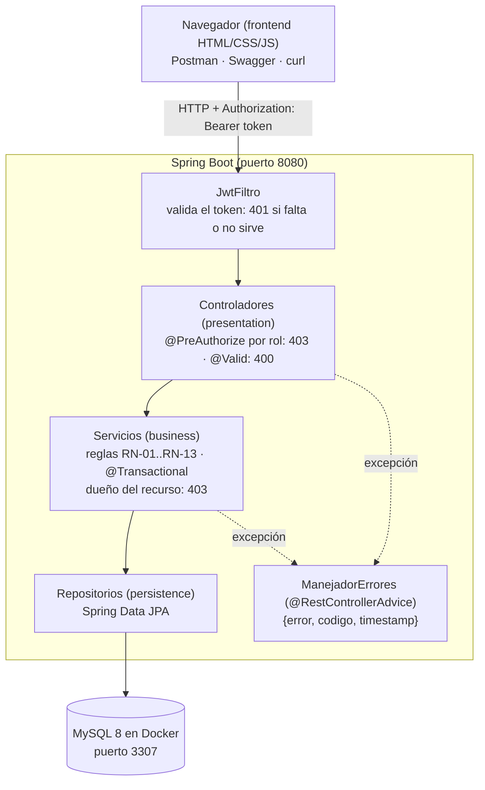

### Modelo de datos

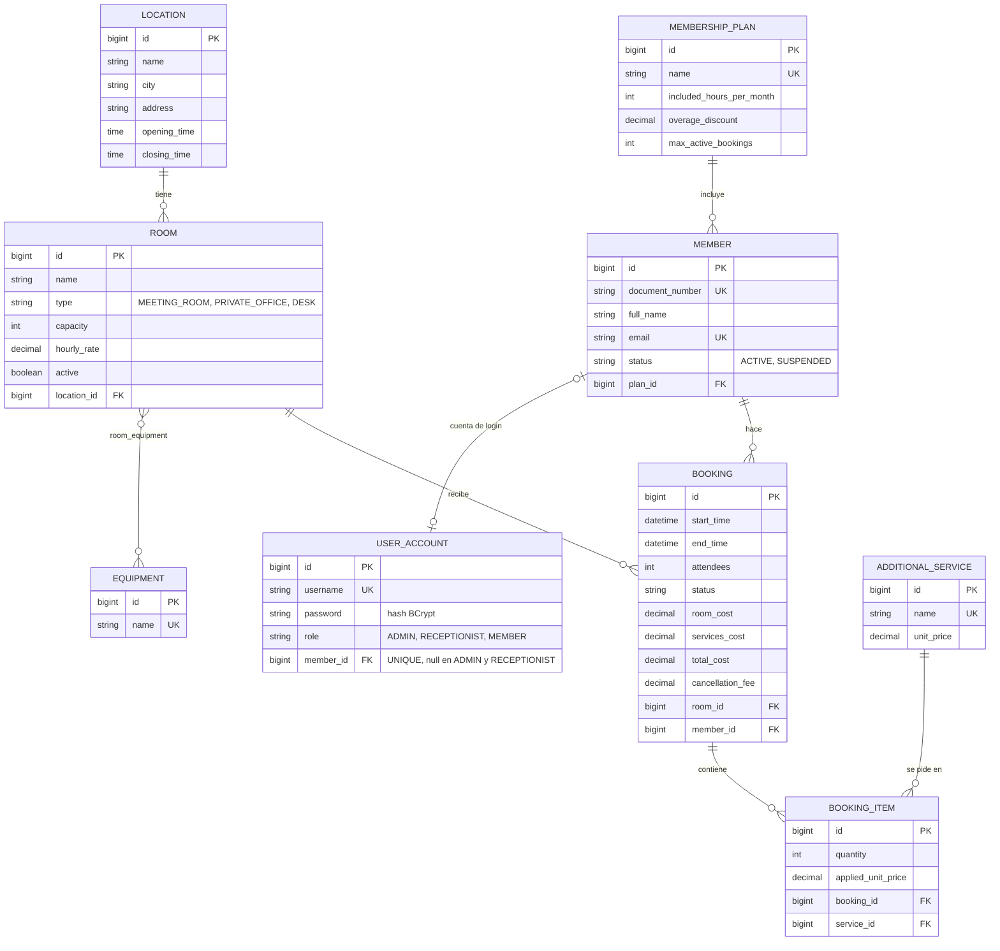

### Estados de una reserva (RN-09)

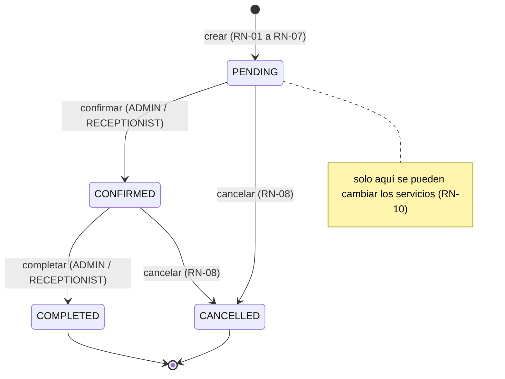

### Crear una reserva sin duplicados (RN-01)

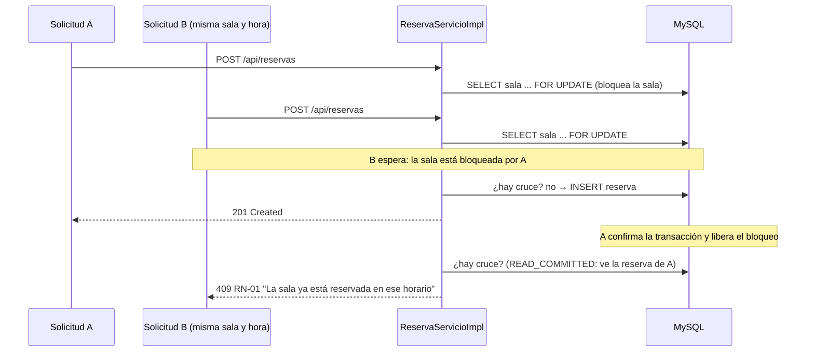

### Cancelación (RN-08)

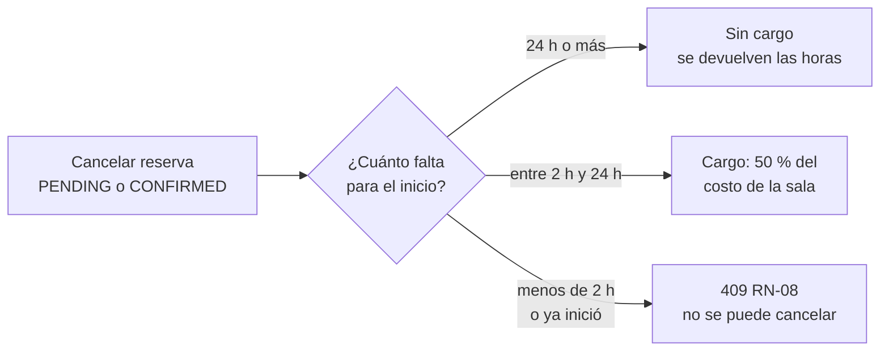

## Cómo usar la API

1. `POST /auth/login` con `{"usuario": "admin", "contrasena": "clave123"}` → devuelve `token`.
2. En Swagger, pulse **Authorize** y pegue el token. En Postman o curl envíe `Authorization: Bearer <token>`.

```bash
curl -X POST http://localhost:8080/auth/login -H "Content-Type: application/json" -d "{\"usuario\":\"ana\",\"contrasena\":\"clave123\"}"
curl http://localhost:8080/api/reservas -H "Authorization: Bearer <token>"
```

| Recurso | Endpoints |
|---|---|
| Autenticación | `POST /auth/login` (público), `GET /auth/perfil` |
| Catálogos | `/api/sedes`, `/api/salas`, `/api/equipamientos`, `/api/servicios-adicionales`, `/api/planes`: `GET`, `GET /{id}`, `POST`, `PUT /{id}`, `DELETE /{id}` |
| Miembros | `GET /api/miembros?nombre=&estado=`, `GET/PUT/DELETE /api/miembros/{id}`, `POST /api/miembros`, `PATCH /{id}/suspender`, `PATCH /{id}/activar`, `GET /{id}/consumo?mes=yyyy-MM` |
| Disponibilidad | `GET /api/disponibilidad?sedeId=&fecha=&horaInicio=&horaFin=&capacidadMinima=&equipamientoIds=` |
| Reservas | `POST /api/reservas`, `GET /api/reservas/{id}`, `GET /api/reservas?miembroId=` · `?salaId=&fecha=` · `?estado=`, `POST /{id}/servicios`, `DELETE /{id}/servicios/{servicioId}`, `POST /{id}/confirmar`, `POST /{id}/cancelar`, `POST /{id}/completar` |

Todo error responde con el mismo cuerpo:

```json
{"error": "La sala ya está reservada en ese horario", "codigo": "RN-01", "timestamp": "2030-06-03T13:00:00Z"}
```

`400` datos inválidos · `401` sin token o token alterado/vencido · `403` sin permiso · `404` no existe ·
`409` regla de negocio (RN-xx) o duplicado.

## Pruebas

- **Postman:** importe `postman/CoWorkHub.postman_collection.json`. Tiene los **14 escenarios de aceptación**
  con sus tests. Reinicie la app antes de correrla (recarga los datos) y ejecútela con el *Collection Runner*.
- **Concurrencia (escenario 13):** con la app corriendo, `powershell -ExecutionPolicy Bypass -File scripts\prueba-concurrencia.ps1`
  lanza 6 reservas iguales al mismo tiempo; debe responder **un 201 y cinco 409**.

¿Cómo se evita la doble reserva simultánea? `RoomRepository.lockById` bloquea la fila de la sala
(`SELECT ... FOR UPDATE`) y la creación corre con `READ_COMMITTED`: la segunda solicitud espera a la primera y
ya ve la reserva guardada.

## Estructura

```
src/main/java/com/coworkhub
├── config/                  ConfiguracionBeans (Clock, PasswordEncoder), ConfiguracionOpenApi
├── persistence/
│   ├── entity/              Location, Room, Equipment, AdditionalService, MembershipPlan,
│   │                        Member, UserAccount, Booking, BookingItem
│   ├── enums/               RoomType, MemberStatus, BookingStatus, Role
│   └── repository/          Spring Data JPA (consultas derivadas, @EntityGraph, bloqueo pesimista)
├── business/
│   ├── service/             interfaces (SedeServicio, ReservaServicio...)
│   ├── service/impl/        implementaciones con las reglas RN-01 a RN-13 y CalculadoraCostos
│   ├── mapper/              entidad -> DTO
│   └── exception/           NoEncontrado, ReglaNegocio, DatosInvalidos, AccesoDenegado...
├── presentation/
│   ├── controller/          controladores REST
│   ├── dto/request|response DTO como record
│   └── advice/              ManejadorErrores (@RestControllerAdvice)
└── security/                ConfiguracionSeguridad, JwtServicio, JwtFiltro, UsuarioActual
src/main/resources
├── application.properties
├── import.sql               datos de prueba (Hibernate)
├── migration.sql            tablas + datos para preparar MySQL a mano
└── static/                  frontend (HTML, CSS, JS)
docs/openapi.json            especificación OpenAPI exportada
postman/                     colección con los 14 escenarios
scripts/                     prueba de concurrencia
```

## Evidencias de funcionamiento

Capturas del frontend y de Swagger funcionando contra MySQL (carpeta [`docs/evidencias/`](docs/evidencias/)).

| | |
|---|---|
| **Login** con usuarios de prueba<br>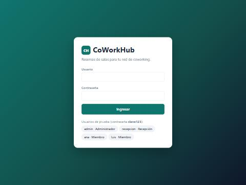 | **Inicio de un MEMBER**: consumo del mes y próximas reservas<br>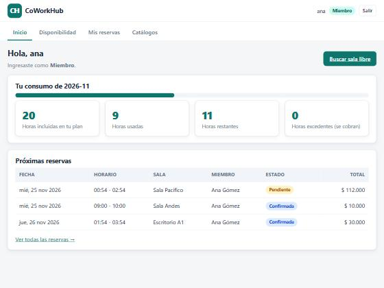 |
| **Inicio del ADMIN**: resumen de reservas, salas y miembros<br>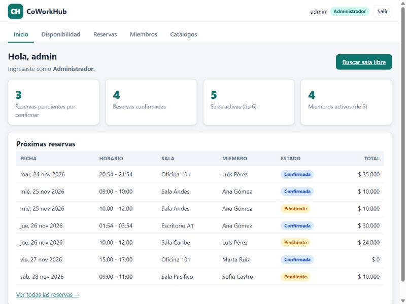 | **Disponibilidad** (RF-03): salas libres por sede, fecha y horario<br>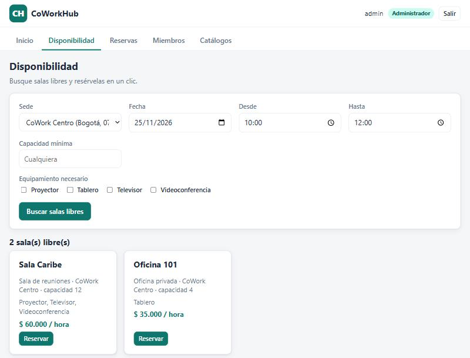 |
| **Nueva reserva** con servicios adicionales (RF-04)<br>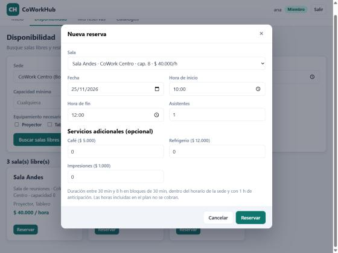 | **Reservas**: confirmar, completar y cancelar según el estado (RN-09)<br>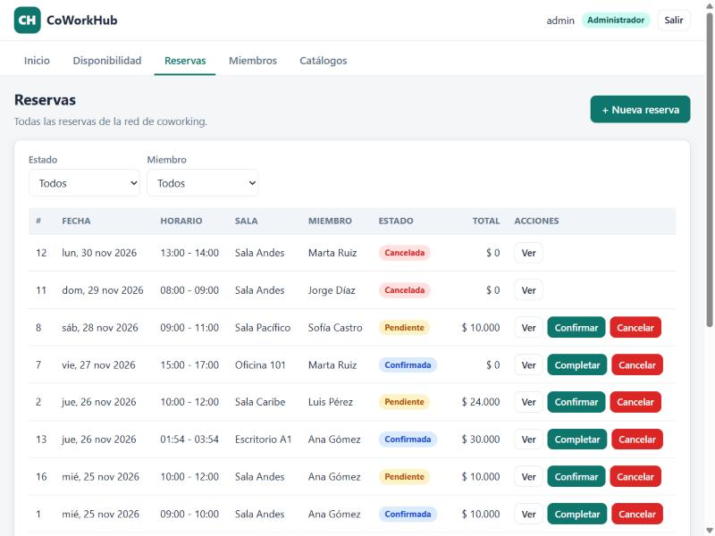 |
| **Cancelación con 5 h**: cargo del 50 % (RN-08)<br>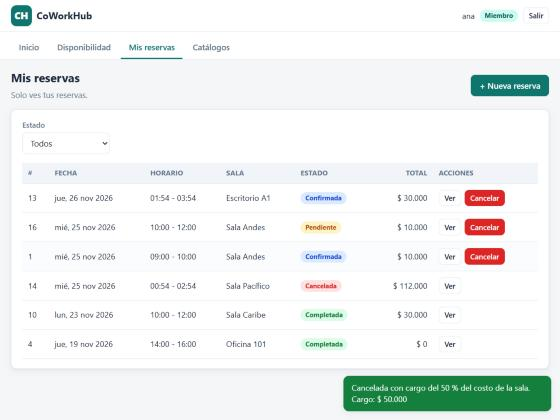 | **Miembros**: registrar, editar, suspender, activar, consumo<br>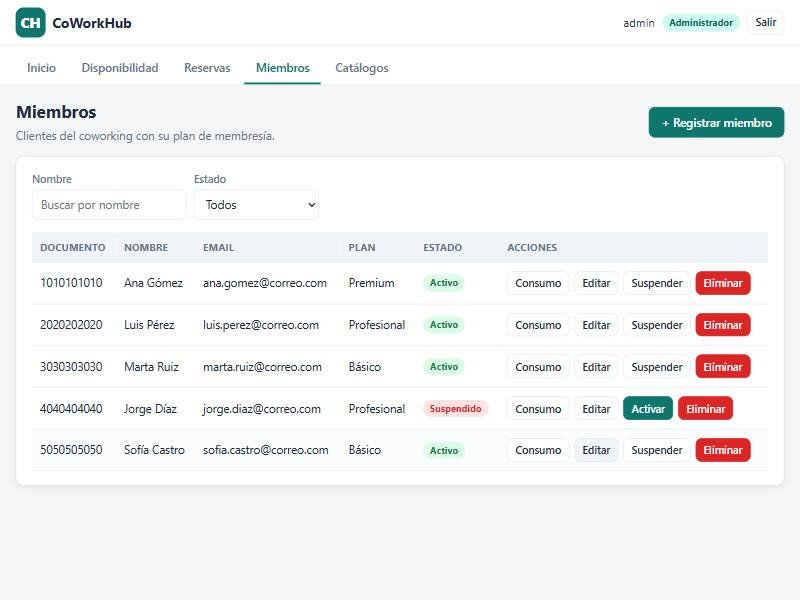 |
| **Error de negocio** con su código: no se elimina un miembro con reservas (RN-12)<br>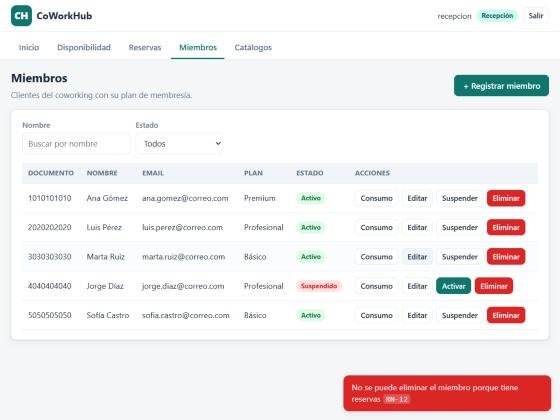 | **Catálogos como ADMIN**: crear, editar y eliminar<br>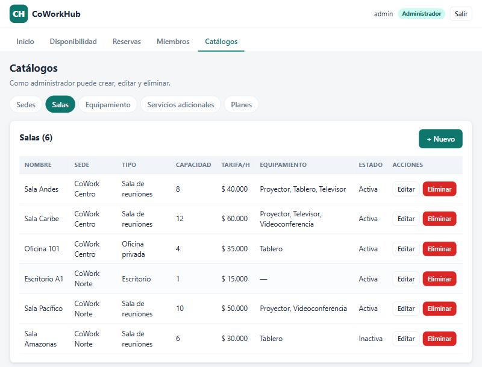 |
| **Catálogos como RECEPTIONIST**: solo consulta (RN-13)<br>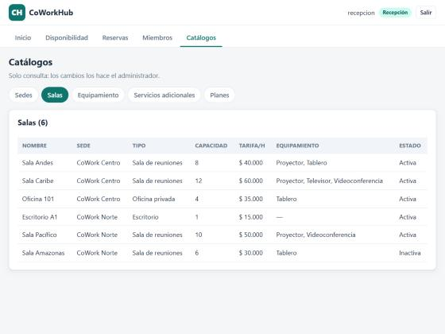 | **Swagger UI** con grupos y botón Authorize<br>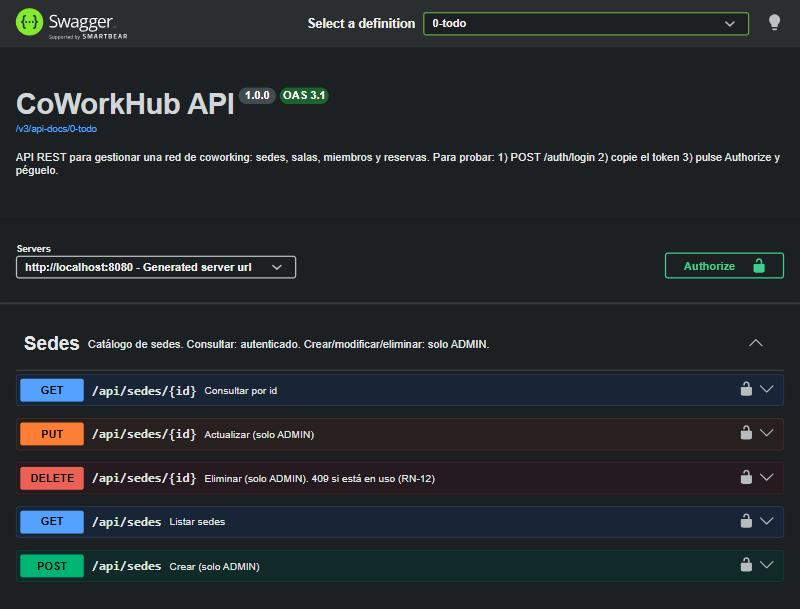 |

Pruebas automáticas ejecutadas:

- Los **14 escenarios** de la colección de Postman responden el código esperado.
- `scripts/prueba-concurrencia.ps1`: `Respuestas: 201, 409, 409, 409, 409, 409` → solo una reserva creada (RN-01).
